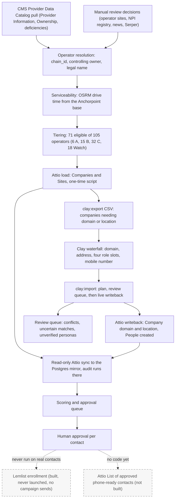
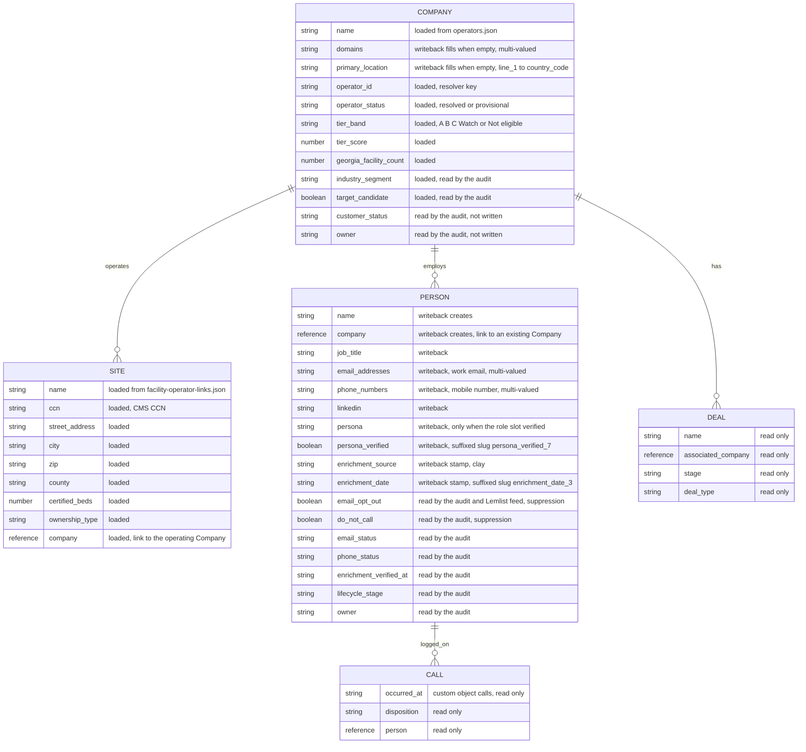
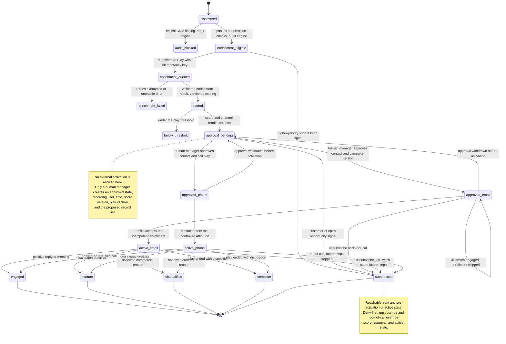

# Diagrams

Status: portfolio reference, 2026-10-22. Status facts come from `STATE.md`; object and field names come from the code under `packages/connectors/src/attio/`, `packages/core/src/attio-mapping.ts`, `scripts/attio-load-georgia.ts`, and `scripts/clay-attio-mapping.ts`. Dashed nodes are steps that were never run or never built.

## 1. Data pipeline

The solid path is what has run. CMS rows were pulled on 2026-10-19 and resolved to operators with the help of dated review decisions, drive time from OSRM set serviceability, the tier script produced the bands, and a one-time script loaded 105 Companies and their facilities as Sites into Attio, where the read-only connector mirrors them into Postgres for the audit. The Clay round trip is a CSV in and a CSV out because the user declined to pay for Clay automation: `clay:export` wrote 105 companies, Clay enriched one proven row (Tift Regional), and `clay:import` wrote that row's domain, address, and four linked People back to Attio with two items in the review queue. Scoring exists only as a script with JSON output, and the approval queue is built on labelled practice fixtures. The dashed nodes are the boundary: the Lemlist connector, ledger, and kill switch are built and tested, but no campaign has ever been launched and no real contact enrolled, and the Attio List for the calling handoff has no code at all (decision 0014). Nothing in this pipeline sends an email or places a call.

## 2. Attio object model

Company and Person are Attio's standard `companies` and `people` objects; Site and Call are custom objects with the default slugs `sites` and `calls` from `packages/connectors/src/attio/objects.ts`. Every attribute on Site, and the operator and tier attributes on Company, were written once by `scripts/attio-load-georgia.ts` and are never touched by writeback. The writeback path in `packages/connectors/src/attio/writeback.ts` is limited to two objects: on `companies` it fills `domains` and `primary_location` only when they are empty, and on `people` it creates a record linked to an existing Company and writes `name`, `job_title`, `email_addresses`, `phone_numbers`, `linkedin`, `persona`, `persona_verified`, `enrichment_source`, and `enrichment_date`. A conflicting human value, an uncertain employer match, a possible duplicate, or an unverified persona goes to the review queue instead. The workspace's suffixed slugs (`persona_verified_7`, `enrichment_date_3`) are translated through `ATTIO_WRITEBACK_SLUGS`. The suppression checkboxes `email_opt_out` and `do_not_call` are read by the audit mapping and the Lemlist feed but are never written by the application. Attio holds no Deals or Calls for the Georgia sample; those objects are mirrored because the audit rules read them, and decision 0010 forbids inventing any history for them.

## 3. Activation state machine

This is `activation-states-v1` from `docs/contracts/activation-state-machine.md`, applied to one contact within one play. The audit engine owns the first branch, the versioned scoring engine owns `scored` and `below_threshold`, and only a human manager can create `approved_email` or `approved_phone`. Connector acceptance, not job submission, creates an active state, and the same idempotency key can never produce a second external action. Approval can be withdrawn before activation; after Lemlist sends a message or a call completes, the event is historical and only future steps can be stopped. The kill switch is a code addition in `packages/connectors/src/lemlist/`: when engaged, every enrollment plan skips with `kill_switch` and the contact stays approved but inactive, which is the self-loop shown on `approved_email`. In practice the states have only been exercised on labelled practice fixtures: no contact has ever reached `active_email` or `active_phone` with real outreach, and `active_phone` has no code behind it yet.
